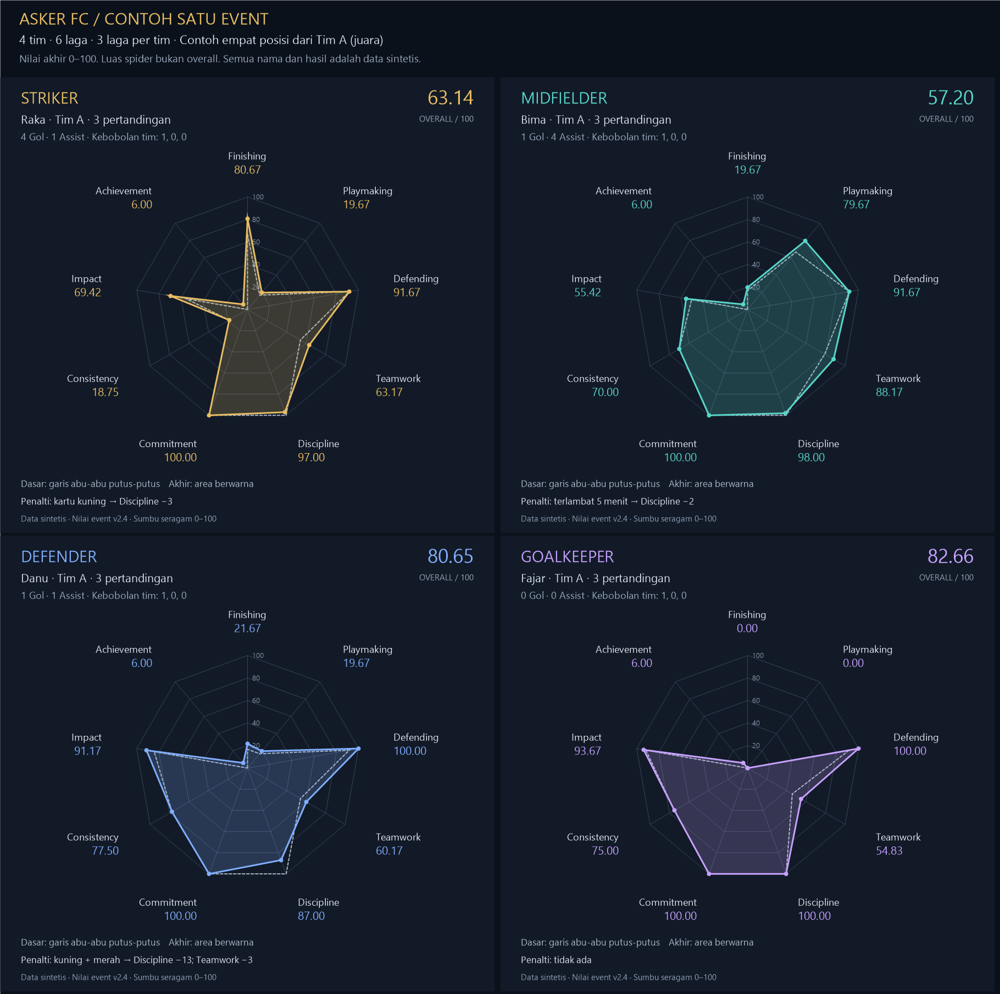
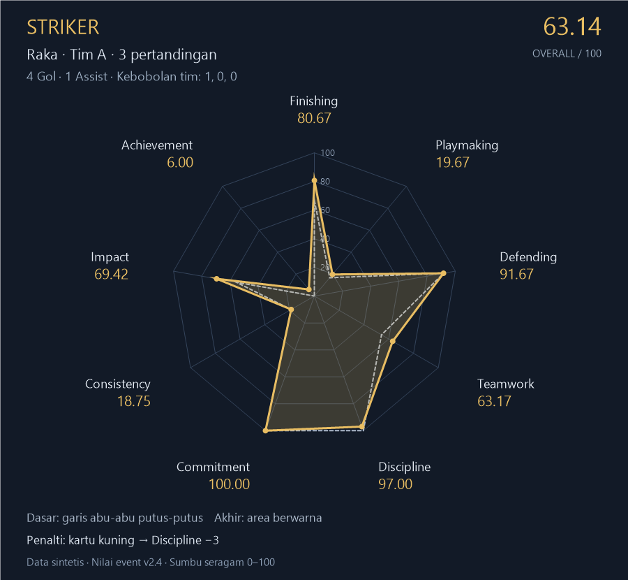
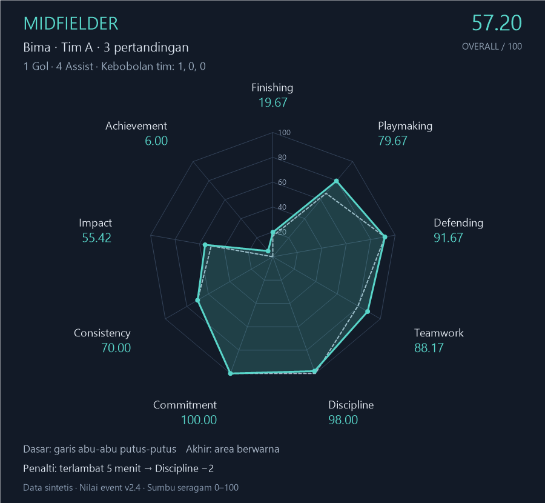
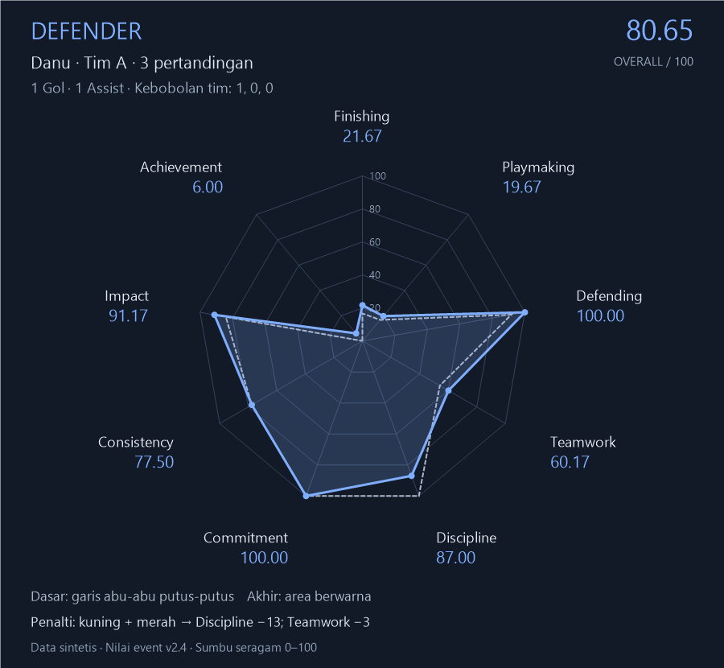
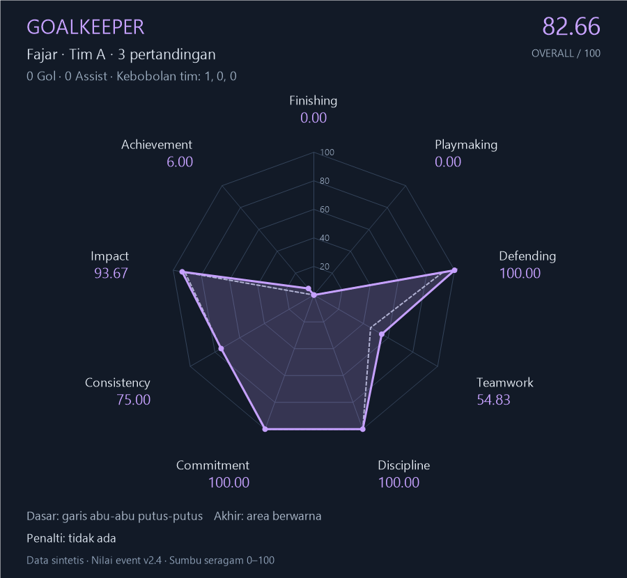

# Contoh statistik satu event — empat posisi

- Versi contoh: 1.0 · 11 November 2026.
- Sumber: [Implementation Plan v2.4](../../00-implementation-plan.md), bagian 13.3–13.6.
- Status: ilustrasi sintetis yang diminta pengguna; bukan data anggota atau perubahan kebijakan SRS.
- Empat pemain contoh berasal dari **Tim A yang sama**, agar konteks hasil tim setara. Mereka bukan seluruh anggota komunitas. Nama B1/B2/C1/C2 adalah pemain pendukung sintetis untuk rekonsiliasi gol/assist tim lain.
- Seluruh pemain contoh hadir dan tampil tiga laga; keterlambatan Bima 5 menit terjadi sebelum pertandingan pertama. Kartu merah Danu terjadi pada akhir M3 (laga terakhir tim), sehingga tidak mengarang penampilan saat skorsing. Semua keputusan contoh dianggap disahkan admin.
- Dipakai usulan Clean Sheet menggantikan Resilience dan Perfect Victory menggantikan Unbeaten. Tidak ada streak sebelum event ini, sehingga tidak ada Consistent Performer. Tidak memakai penalti absen/keterlambatan yang nominalnya belum jelas.
- Grafik ini menampilkan **nilai event**, Consistency = 100 − rentang R tiga laga. Rumus Consistency profil sepanjang waktu berbeda dan tidak dipakai.

## Grafik spider

Garis putus-putus = dasar; area berwarna = sesudah bonus, cap dan penalti. Semua sumbu 0–100. Luas polygon bukan rumus overall. [Buka tampilan interaktif](./index.html); [SVG gabungan](./spider-semua-posisi.svg); [Data perhitungan](./data-perhitungan.json).

## Enam pertandingan

| Laga | Pertandingan | Skor | Gol pertama | Gol penentu | Comeback |
|---|---|---|---|---|---|
| M1 | A–B | 3–1 | B1 | S | Ya |
| M2 | A–C | 2–0 | S | S | Tidak |
| M3 | A–D | 1–0 | D | D | Tidak |
| M4 | B–C | 1–1 | B1 | — | Tidak |
| M5 | B–D | 2–0 | B1 | B1 | Tidak |
| M6 | C–D | 1–0 | C1 | C1 | Tidak |

ID S=Raka, M=Bima, D=Danu, G=Fajar. Huruf D pada kolom tim berarti Tim D, sedangkan ID pemain D berarti Danu dari Tim A.

## Klasemen final

| Peringkat | Tim | Main | M | S | K | GM | GK | SG | Poin |
|---|---|---|---|---|---|---|---|---|---|
| 1 | A | 3 | 3 | 0 | 0 | 6 | 1 | 5 | 9 |
| 2 | B | 3 | 1 | 1 | 1 | 4 | 4 | 0 | 4 |
| 3 | C | 3 | 1 | 1 | 1 | 2 | 3 | -1 | 4 |
| 4 | D | 3 | 0 | 0 | 3 | 0 | 4 | -4 | 0 |

A mendapat Champion, Perfect Victory, Best Attack (6 gol) dan Best Defense (1 kebobolan). M1 memberikan Comeback Victory. Tim D mendapat Last Place dan Winless; tidak diterapkan kepada empat contoh pemain Tim A.

## Rekonsiliasi gol dan assist

Urutan berikut hanya bukti konsistensi data contoh untuk metadata kejadian khusus; bukan kewajiban input kronologi tambahan. Setiap entri: tim / pencetak / assist.

- M1: B / B1 / B2 → A / S / M → A / S / D → A / M / S
- M2: A / S / M → A / S / M
- M3: A / D / M
- M4: B / B1 / B2 → C / C1 / C2
- M5: B / B1 / B2 → B / B2 / B1
- M6: C / C1 / C2

## Ringkasan sembilan kategori

| Kategori | Raka (Striker) | Bima (Midfielder) | Danu (Defender) | Fajar (Goalkeeper) |
|---|---|---|---|---|
| Finishing | 80.67 | 19.67 | 21.67 | 0.00 |
| Playmaking | 19.67 | 79.67 | 19.67 | 0.00 |
| Defending | 91.67 | 91.67 | 100.00 | 100.00 |
| Teamwork | 63.17 | 88.17 | 60.17 | 54.83 |
| Discipline | 97.00 | 98.00 | 87.00 | 100.00 |
| Commitment | 100.00 | 100.00 | 100.00 | 100.00 |
| Consistency | 18.75 | 70.00 | 77.50 | 75.00 |
| Impact | 69.42 | 55.42 | 91.17 | 93.67 |
| Achievement | 6.00 | 6.00 | 6.00 | 6.00 |
| Overall | 63.14 | 57.20 | 80.65 | 82.66 |

Overall = 70% Impact + 5% Teamwork + 5% Discipline + 5% Commitment + 5% Consistency + 10% Achievement. Perhitungan menggunakan presisi penuh; pembulatan hanya tampilan.

## Raka — Striker

| Laga | Gol | Assist | Kebobolan | F | P | D | R dasar |
|---|---|---|---|---|---|---|---|
| M1 | 2 | 1 | 1 | 100 | 50 | 75 | 86.25 |
| M2 | 2 | 0 | 0 | 100 | 0 | 100 | 75.00 |
| M3 | 0 | 0 | 0 | 0 | 0 | 100 | 5.00 |

| Kategori | Dasar | Bonus nominal | Bonus efektif setelah cap | Penalti | Akhir |
|---|---|---|---|---|---|
| Finishing | 66.67 | +14 | +14.00 | −0 | 80.67 |
| Playmaking | 16.67 | +3 | +3.00 | −0 | 19.67 |
| Defending | 91.67 | +0 | +0.00 | −0 | 91.67 |
| Teamwork | 54.17 | +9 | +9.00 | −0 | 63.17 |
| Discipline | 100.00 | +0 | +0.00 | −3 | 97.00 |
| Commitment | 100.00 | +4 | +0.00 | −0 | 100.00 |
| Consistency | 18.75 | +0 | +0.00 | −0 | 18.75 |
| Impact | 55.42 | +14 | +14.00 | −0 | 69.42 |
| Achievement | 0.00 | +6 | +6.00 | −0 | 6.00 |

| Achievement | Sumber | Bonus |
|---|---|---|
| Goal Scorer | M1 | Finishing +3 |
| Brace | M1 | Finishing +3 |
| Assist Maker | M1 | Playmaking +3 |
| Goal Contribution | M1 | Impact +3 |
| Match Winner | M1 | Impact +4 |
| Comeback Victory | M1 | Teamwork +3 |
| Goal Scorer | M2 | Finishing +3 |
| Brace | M2 | Finishing +3 |
| First Blood | M2 | Finishing +2, Impact +1 |
| Match Winner | M2 | Impact +4 |
| Perfect Attendance | Event | Commitment +4 |
| Champion | Event | Achievement +6 |
| Perfect Victory | Event | Teamwork +6 |
| Best Attack | Event | Impact +2 |

Penalti: Kartu kuning (M2): Discipline −3.

## Bima — Midfielder

| Laga | Gol | Assist | Kebobolan | F | P | D | R dasar |
|---|---|---|---|---|---|---|---|
| M1 | 1 | 1 | 1 | 50 | 50 | 75 | 51.25 |
| M2 | 0 | 2 | 0 | 0 | 100 | 100 | 65.00 |
| M3 | 0 | 1 | 0 | 0 | 50 | 100 | 35.00 |

| Kategori | Dasar | Bonus nominal | Bonus efektif setelah cap | Penalti | Akhir |
|---|---|---|---|---|---|
| Finishing | 16.67 | +3 | +3.00 | −0 | 19.67 |
| Playmaking | 66.67 | +13 | +13.00 | −0 | 79.67 |
| Defending | 91.67 | +0 | +0.00 | −0 | 91.67 |
| Teamwork | 79.17 | +9 | +9.00 | −0 | 88.17 |
| Discipline | 100.00 | +0 | +0.00 | −2 | 98.00 |
| Commitment | 100.00 | +4 | +0.00 | −0 | 100.00 |
| Consistency | 70.00 | +0 | +0.00 | −0 | 70.00 |
| Impact | 50.42 | +5 | +5.00 | −0 | 55.42 |
| Achievement | 0.00 | +6 | +6.00 | −0 | 6.00 |

| Achievement | Sumber | Bonus |
|---|---|---|
| Goal Scorer | M1 | Finishing +3 |
| Assist Maker | M1 | Playmaking +3 |
| Goal Contribution | M1 | Impact +3 |
| Comeback Victory | M1 | Teamwork +3 |
| Assist Maker | M2 | Playmaking +3 |
| Playmaker | M2 | Playmaking +4 |
| Assist Maker | M3 | Playmaking +3 |
| Perfect Attendance | Event | Commitment +4 |
| Champion | Event | Achievement +6 |
| Perfect Victory | Event | Teamwork +6 |
| Best Attack | Event | Impact +2 |

Penalti: Terlambat 5 menit tanpa alasan mendesak (Event): Discipline −2.

## Danu — Defender

| Laga | Gol | Assist | Kebobolan | F | P | D | R dasar |
|---|---|---|---|---|---|---|---|
| M1 | 0 | 1 | 1 | 0 | 50 | 75 | 70.00 |
| M2 | 0 | 0 | 0 | 0 | 0 | 100 | 90.00 |
| M3 | 1 | 0 | 0 | 50 | 0 | 100 | 92.50 |

| Kategori | Dasar | Bonus nominal | Bonus efektif setelah cap | Penalti | Akhir |
|---|---|---|---|---|---|
| Finishing | 16.67 | +5 | +5.00 | −0 | 21.67 |
| Playmaking | 16.67 | +3 | +3.00 | −0 | 19.67 |
| Defending | 91.67 | +15 | +8.33 | −0 | 100.00 |
| Teamwork | 54.17 | +9 | +9.00 | −3 | 60.17 |
| Discipline | 100.00 | +0 | +0.00 | −13 | 87.00 |
| Commitment | 100.00 | +4 | +0.00 | −0 | 100.00 |
| Consistency | 77.50 | +0 | +0.00 | −0 | 77.50 |
| Impact | 84.17 | +7 | +7.00 | −0 | 91.17 |
| Achievement | 0.00 | +6 | +6.00 | −0 | 6.00 |

| Achievement | Sumber | Bonus |
|---|---|---|
| Assist Maker | M1 | Playmaking +3 |
| Defensive Resilience | M1 | Defending +2 |
| Comeback Victory | M1 | Teamwork +3 |
| Clean Sheet | M2 | Defending +5 |
| Goal Scorer | M3 | Finishing +3 |
| First Blood | M3 | Finishing +2, Impact +1 |
| Match Winner | M3 | Impact +4 |
| Clean Sheet | M3 | Defending +5 |
| Perfect Attendance | Event | Commitment +4 |
| Champion | Event | Achievement +6 |
| Perfect Victory | Event | Teamwork +6 |
| Best Attack | Event | Impact +2 |
| Best Defense | Event | Defending +3 |

Penalti: Kartu kuning (M1): Discipline −3; Kartu merah langsung pada akhir laga terakhir (M3): Discipline −10, Teamwork −3.

## Fajar — Goalkeeper

| Laga | Gol | Assist | Kebobolan | F | P | D | R dasar |
|---|---|---|---|---|---|---|---|
| M1 | 0 | 0 | 1 | 0 | 0 | 75 | 75.00 |
| M2 | 0 | 0 | 0 | 0 | 0 | 100 | 100.00 |
| M3 | 0 | 0 | 0 | 0 | 0 | 100 | 100.00 |

| Kategori | Dasar | Bonus nominal | Bonus efektif setelah cap | Penalti | Akhir |
|---|---|---|---|---|---|
| Finishing | 0.00 | +0 | +0.00 | −0 | 0.00 |
| Playmaking | 0.00 | +0 | +0.00 | −0 | 0.00 |
| Defending | 91.67 | +15 | +8.33 | −0 | 100.00 |
| Teamwork | 45.83 | +9 | +9.00 | −0 | 54.83 |
| Discipline | 100.00 | +0 | +0.00 | −0 | 100.00 |
| Commitment | 100.00 | +4 | +0.00 | −0 | 100.00 |
| Consistency | 75.00 | +0 | +0.00 | −0 | 75.00 |
| Impact | 91.67 | +2 | +2.00 | −0 | 93.67 |
| Achievement | 0.00 | +6 | +6.00 | −0 | 6.00 |

| Achievement | Sumber | Bonus |
|---|---|---|
| Defensive Resilience | M1 | Defending +2 |
| Comeback Victory | M1 | Teamwork +3 |
| Clean Sheet | M2 | Defending +5 |
| Clean Sheet | M3 | Defending +5 |
| Perfect Attendance | Event | Commitment +4 |
| Champion | Event | Achievement +6 |
| Perfect Victory | Event | Teamwork +6 |
| Best Attack | Event | Impact +2 |
| Best Defense | Event | Defending +3 |

Penalti: tidak ada.

## Temuan model dari contoh

- Achievement hanya 6 untuk juara; grafik mempertahankan 6 pada skala 100, bukan menaikkannya agar terlihat penuh.
- Commitment dasar 100 membuat Perfect Attendance +4 memberi bonus efektif 0. Bonus defensif juga dapat tertahan pada 100.
- Consistency Striker rendah karena R berubah dari 86,25 menjadi 75 lalu 5, meskipun mencetak empat gol dalam event.
- GK/Defender dapat memperoleh overall tinggi tanpa banyak Gol/Assist karena bobot pertahanan. Ini contoh mekanika, belum bukti bahwa model telah adil atau terkalibrasi.
- Bonus Finishing/Playmaking/Defending tidak dihitung ulang ke Impact; Impact hanya menerima bonus Impact langsung.
- Gambar adalah grafik statistik, bukan pengganti subset 12 mockup UI. Tidak ada dokumen SRS turunan yang diproses.
